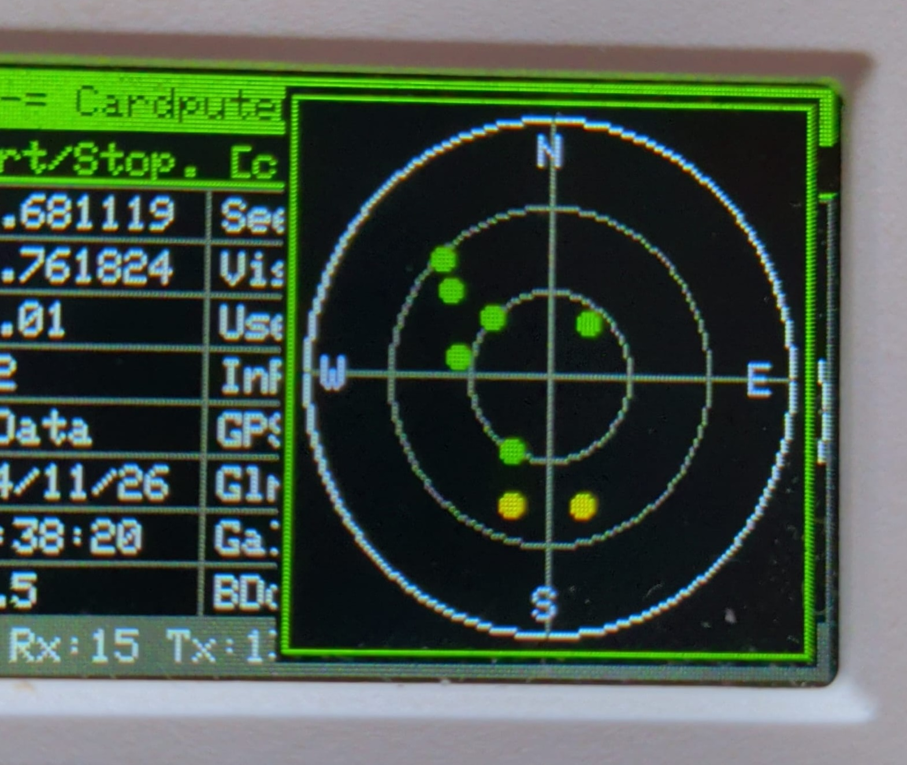
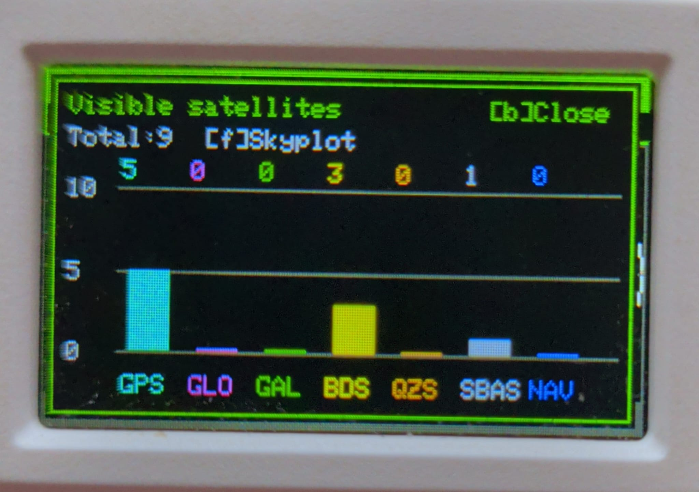

# Cardputer GPS Info

Cardputer GPS Info is a lightweight GPS information tool for the M5Stack Cardputer.  
It reads GPS data via UART and displays location, speed, course, satellite visibility, and sky plots directly on the Cardputer screen.


## Changelog
1.2.1 - Verify the ADV keyboard controller before selecting its driver.
      - Start on the main screen without microSD; add visible and USB startup diagnostics.

1.2.0 packaging update (2026-11-02) - Added one complete binary for both M5Burner and M5Launcher.

1.2.0 - Added Grove, Cap LoRa-1262 and Ares GPS profiles plus manual settings.
      - Fixed keyboard handling, popup overlays, satellite counts and stale metrics.
      - Added configurable USB serial baudrate, enlarged skyplot and constellation bars.
      - Added Apache-2.0 licensing, build configuration and regression tests.
1.1.0 - Added configuration file support on microSD (cpGpsInfo.conf) to store GPS RX/TX pins and baudrate.
      - Added ability to modify GPS baudrate.
      - Fixed minor bugs.
      - Added GPS error state (on,off,err).
1.0.0 - First release.

## ToDo
- Validate the Grove GPS profile on physical hardware when a module is available.

## Features

- Display GPS data: Latitude, Longitude, Altitude, Speed, Course, Date, Time, HDOP
- Track all satellites ever seen, currently visible, and those used in the fix
- Sky plot of satellites with color-coded status:
  - Green: used in fix
  - Yellow: visible
  - Red: previously positioned, no longer visible
- Optionally show satellite ID and system on the plot


- Keyboard control:
  - `[s]` Start/Stop GPS serial
  - `[c]` Configuration menu
  - `[h]` Help menu
  - `[l]` Print satellite list to USB serial
  - `[n]` Print NMEA sentences to USB serial
  - `[p]` Show/hide satellite ID on sky plot
  - `[o]` Show/hide system on sky plot
  - `[f]` Open/close the enlarged skyplot popup
  - `[b]` Open/close the visible-satellites bar chart


## Hardware

- M5Stack Cardputer (1, 1.1, ADV)
- GPS module connected to configurable TX/RX pins (configurables[c] key)


## GPS configuration

Press `c` to open configuration. Use `;` / `.` for up/down and `,` / `/`
for left/right (the arrow-labelled keys). On the Profile row, left/right selects:

| Profile | Cardputer RX | Cardputer TX | Baud |
| --- | ---: | ---: | ---: |
| Grove GPS (M5Stack Unit GPS) | 1 | 2 | 9600 |
| ADV Cap LoRa-1262 | 15 | 13 | 115200 |
| ADV Ares PCB v0.8 | 15 | 13 | 115200 |
| Manual | editable | editable | editable |

RX and TX always refer to the **Cardputer**: GPS TX connects to Cardputer RX,
and GPS RX connects to Cardputer TX. Select the profile matching the attached
hardware. The two ADV expansion profiles also deselect their radio peripherals
while using the shared microSD SPI bus. Ares keeps its IR transmitter off.

To customize a preset, select it first, then press `m` to enter Manual directly.
Manual keeps the hardware of the last selected preset,
shown as `Base`, while allowing RX, TX and baud to be edited separately. Use
Backspace to clear a value and the number keys to enter its replacement. Pins
reserved for onboard peripherals and the selected expansion are rejected.

Enter applies the complete configuration and saves it to `/cpGpsInfo.conf` on
microSD. The menu stays open to show the save result. Press `c` to close it,
then `s` to start GPS. Opening configuration stops GPS; cancelling does not
apply draft values or restart it. Without a working SD card, values are applied
only until power-off, and a message reports this explicitly.

The app starts on the main screen even without microSD or a valid configuration.
Press `c` to choose a GPS profile before starting reception. Old files containing
`gpsRxPin`, `gpsTxPin` and `gpsBaud` remain readable
as Manual with the Grove hardware base. For an existing Ares installation,
select the Ares profile explicitly once; UART pin numbers alone cannot identify
the attached expansion board.

GPS status labels:

| Label | Meaning |
| --- | --- |
| Off | UART stopped |
| Wait | UART started; waiting for initial traffic |
| NoRx | No bytes received for at least 3 seconds |
| NMEA? | Bytes received, but no recent complete sentence with valid checksum |
| NMEA | Valid NMEA received; no current position fix |
| Fix | Valid stream and a current position fix |

## Build and verification

The project includes `platformio.ini` for the ESP32-S3 used by both
Cardputer variants. From this folder, with PlatformIO installed, run:

```sh
pio run
```

The build pins the ESP32 platform and library versions. It produces one distribution
file, `build/release/Cardputer_GPS_Info-1.2.1-universal.bin`, containing the
bootloader, partition table, OTA initialization and application. Use this same file
for M5Burner publication/direct USB flashing at **0x0**, or install it using
M5Launcher, which extracts the application from the complete image. Building does
not flash the device. Direct USB flashing replaces the installed launcher.

`.pio/build/cardputer/firmware.bin` is an intermediate application-only image;
do not upload it to M5Burner or flash it at 0x0.
Arduino IDE is also supported: open `Cardputer_GPS_Info.ino`, keep
the `GpsConfig.h`, `GpsMetrics.h`, `GpsViews.h`, `GpsPopup.h` headers beside it, enable USB
CDC on boot, and install the libraries listed in
`platformio.ini`. SD pins are explicit and do not depend on the board variant.

The retained host regression tests cover presets, manual validation, old/new configuration
formats, key holds/chord changes, NMEA checksums, reception timeouts, satellite
identity, complete GSV cycles, signal bands and individual metric validity:

`python3 tests/CardputerStartupTest.py` also checks the sketch's startup functions
with simulated peripherals: keyboard selection despite an incorrect board ID,
controller retries, I2C initialization failures and SD/configuration states. This
is a control-flow test, not an ESP32 emulator or a physical hardware validation.
During startup, progress is shown on the display and logged to USB serial at
115200 baud without waiting for a connected computer. For a failed boot, record
the last displayed stage and capture the USB log from reset. The earliest ROM
messages may require the chip's UART console rather than USB CDC.

```sh
c++ -std=c++11 -Wall -Wextra -Werror tests/GpsConfigTest.cpp -o /tmp/cardputer-gps-test
/tmp/cardputer-gps-test
c++ -std=c++11 -Wall -Wextra -Werror tests/GpsMetricsTest.cpp -o /tmp/cardputer-gps-metrics-test
/tmp/cardputer-gps-metrics-test
c++ -std=c++11 -Wall -Wextra -Werror tests/GpsViewsTest.cpp -o /tmp/cardputer-gps-views-test
/tmp/cardputer-gps-views-test
c++ -std=c++11 -Wall -Wextra -Werror tests/GpsPopupTest.cpp -o /tmp/cardputer-gps-popup-test
/tmp/cardputer-gps-popup-test
```

The decoder integration test also runs the unmodified TinyGPS++ source. After
PlatformIO has downloaded the libraries, it can be run with:

```sh
c++ -std=c++11 -Wall -Wextra -Itests/support -I.pio/libdeps/cardputer/TinyGPSPlus/src \
  tests/GpsDecoderTest.cpp .pio/libdeps/cardputer/TinyGPSPlus/src/TinyGPS++.cpp \
  -o /tmp/cardputer-gps-decoder-test
/tmp/cardputer-gps-decoder-test
```

Device verification checklist:

For 1.2.1, repeat installation via M5Burner and M5Launcher on both original
Cardputer and ADV, with and without microSD. Check that the main screen appears,
`c` opens/closes settings, and `s` starts reception. Original hardware validation
is pending; the previous 1.2.0 ADV results do not validate this new build.

1. Hold `c`: the menu must open once and remain stable. Check both navigation
   directions, editing with Backspace, and Enter / `c` while keys are held.
2. On Ares, select `ADV Ares PCB v0.8`, apply, close with `c`, start with `s`.
   Expect `NMEA`, then `Fix` outdoors when a position becomes available.
   Confirm keyboard operation and that IR transmitters remain off.
3. Press `m` from Ares and change only baud to 9600. Confirm the Ares base
   is retained and that traffic does not produce a false `Fix`. Restore 115200.
4. Save and power-cycle with SD inserted: profile, hardware base and values
   must reload. Check the visible RAM-only message when saving without SD.
5. Repeat with the official Cap (its own profile) and a Grove GPS (its own
   profile). These are separate hardware checks, not implied by an Ares test.
6. Stop and restart GPS after a long idle period; there must be a fresh grace
   period. Disconnect GPS with power off, then verify `NoRx` on the next run.

## Main-screen metrics

- `Seen`: distinct identified satellites reported in GSV or GSA during the
  current GPS session, including satellites with no available sky position.
- `Used`: distinct identified satellites reported as used in a valid GSA fix
  at least once during the session. This is history, not the current fix count.
- `Visb`: unique satellites in recent, complete GSV sequences, unioned across
  signal bands. An empty complete sequence reports zero. Incomplete sequences
  do not replace the last complete snapshot. Each snapshot expires after 15 s;
  live counts disappear sooner if the NMEA stream itself stops.
- `InFx`: the fresh satellite count reported in GGA, or zero after a fresh
  no-fix navigation report. `--` means the required current data is unavailable.
- `GPS`, `Gln`, `Gal`, `BDo`: the currently visible GPS, GLONASS, Galileo and
  BeiDou satellites. SBAS, QZSS and NavIC remain included in `Visb` and in the
  bar chart. The compact skyplot temporarily hides the `Oth` label to avoid
  overlapping the map.

Repeated observations of the same satellite in different bands count once.
Satellite IDs are interpreted together with the constellation, including the
NMEA 4.10 GSA system identifier. A mixed `GN` local ID without a system identifier
can be ambiguous: it is not assigned to an arbitrary constellation. A `?` after
a count marks a partial known count; historical uncertainty lasts for the
session. GSA lists for one constellation are combined within a bounded 250 ms
burst or UTC epoch because some receivers emit more than one GSA for that system.
IDs in the plot and USB list are normalized within each constellation, so a
GLONASS slot or SBAS PRN can differ from the raw number in an NMEA frame.

The skyplot uses green for satellites in the **current** GSA solution, yellow
for other currently visible satellites, and red for previously positioned
satellites no longer visible. Satellites with no reported azimuth/elevation
are counted but are not plotted at a fabricated position. `l` prints current
use (`Now`), historical use (`Ever`) and visibility separately on USB serial.

Latitude/longitude are decimal degrees, altitude is metres above mean sea
level, speed is km/h, course is degrees from true north, and `UTC` is UTC time.
HDOP is dimensionless; it is not a position error in metres. Numeric fields
must be present, valid and recent (5 s), in addition to a current stream.
Position-dependent fields also require a current fix. Missing or expired data
shows `NoData`/`NoFix`; a real valid zero speed is still displayed as `0.0`.
Stopping GPS clears live status but preserves `Seen`/`Used`; starting it again
begins a new session.

For device verification, watch `Visb`/constellation counts and green skyplot
points while reception changes, then stop GPS and check that only history
remains. Test both Ares and the official Cap; the Grove device test remains
pending until hardware is available.

## NMEA sentences to USB serial `[n]`

If you wat to share the cardputer gps data via serial to another software now you can!
Press n, with the cardputer connected via usb, open your nmea software, select the port, enjoy!


## Print satellite list to USB serial `[l]`


## USB settings and graphical popups

Configuration includes separate `GPS baud` and `USB baud` rows. USB baud can be
edited with any GPS profile; it is independent of Manual mode and is preserved
when browsing presets. Enter applies and saves both rates. The `usbBaud` key is
optional in old configuration files and defaults to 115200. If the console is
already active, applying a different USB baud restarts it with the new setting.
The help popup no longer shows a fixed console baudrate.

The Cardputer uses native USB CDC: the selected value is passed to the serial
API, but it does not change the physical USB link speed or throttle NMEA output.
On builds using a UART serial console it sets that console's baudrate.

- `f`: open/close an enlarged square skyplot at the top right, with a green
  frame, black shadow and no surrounding text. Live GPS reception continues.
  `p` toggles IDs, `o` toggles constellation labels, and both can be shown together.
- `b`: open/close a live bar chart of **currently visible satellites per
  constellation**: GPS, GLONASS, Galileo, BeiDou, QZSS, SBAS and NavIC. The axis
  adapts to the largest count; the sum of all bars equals `Visb`, including SBAS, QZSS and NavIC.
- Press `f` or `b` to switch directly between the graphical popups. Backspace
  also closes either popup. `c`, `h` and `i` switch to the existing dialogs.




The bar-chart popup has a 5-pixel margin on every side. Both graphics refresh
once per second with a buffered frame to avoid blanking
the LCD during updates. With no current GSV data, the bars show `--`, rather than
claiming that zero satellites are visible. Partial counts retain the `?` marker.

To verify configuration, change and save USB baud without switching to Manual,
then power-cycle to check persistence. Start GPS and check `f`, `p`, `o`, `b`,
closing/reopening popups and switching to Help/Info. Compare the bar total with
the main screen's `Visb`, and confirm that GPS continues updating in both popups.

## Shared popup rendering

All dialogs use `createPopup(x, y, width, height)` to compose their container over
the main screen. The function redraws the main view into the shared buffer,
adds a black fill, green frame and 2-pixel outer black border, then clips drawing
to the inside of the frame. Each dialog draws its own contents and calls
`finishPopup()` to present the combined image.

The main view remains visible outside the popup, including the left-hand
metrics beside the square skyplot. Switching dialogs recreates the main
background first, so parts of the previous popup cannot remain underneath.
Live graphical popups still refresh without stopping GPS reception.

## License

Cardputer GPS Info is licensed under the Apache License, Version 2.0
(Apache-2.0). See [LICENSE](LICENSE) for the complete license text and
[NOTICE](NOTICE) for copyright and attribution information.

Third-party dependencies retain their respective licenses and attributions.
